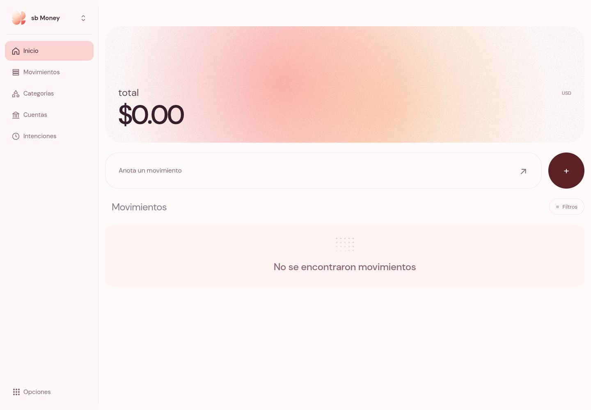
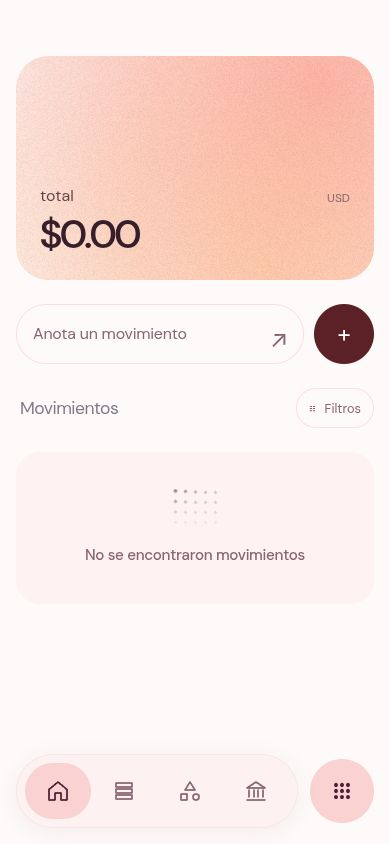

<div align="center">

# Stepbro · Money

**Una idea entre amigos. Una base para tus próximas apps.**

Una plantilla de finanzas hecha con Vue, colores suaves y animaciones cuidadas.
Para explorar, aprender y convertirla en algo tuyo.

[Empezar](#empezar) · [Personalizar](#hazla-tuya) · [Qué incluye](#qué-incluye)

</div>



## La idea

Quiero ayudar a mis amigos a crear sus propias apps con plantillas como esta: tener una base que se vea bien, poder mirar cómo está hecha y empezar a cambiar cosas sin arrancar desde cero.

Money es el punto de partida. Puedes tomar sus componentes, probar otros colores, adaptar la navegación o darle una función diferente. El proyecto sigue creciendo mientras aprendemos y lo usamos.

## Qué incluye

- **Finanzas:** ingresos, gastos, transferencias, cuentas, categorías e intenciones.
- **Tu color:** diez paletas que también adaptan el logo SVG y el degradado animado.
- **Navegación adaptable:** barra clásica, flotante o dock en escritorio; barra inferior en celular.
- **Movimiento:** paneles y menús con transiciones de GSAP y gestos para cerrarlos.
- **Componentes para reutilizar:** selectores, filtros, diálogos y estados vacíos animados.
- **Backend propio:** Laravel + PostgreSQL, cuentas de usuario y guardado confirmado por el servidor. [Configurar backend](backend/README.md).
- **Modo local:** disponible al desactivar `VITE_FINANCE_API`; las preferencias visuales permanecen en el navegador.

<details>
<summary><strong>Así se ve en celular</strong></summary>
<br>
<p align="center">
  
</p>
</details>

## Empezar

Necesitas **Node.js 22.12 o superior** y npm.

```bash
git clone https://github.com/4sapp/stepbro.git
cd stepbro
npm install
npm run dev
```

Abre la dirección que aparece en la terminal. Para tu propia versión, puedes hacer un fork de este repositorio antes de clonarlo.

## Hazla tuya

| Quiero cambiar… | Dónde empezar |
| --- | --- |
| Los colores y el tema | `src/composables/useAppearanceTheme.js` |
| El logo | `src/assets/appLogo.js` y `src/components/AppLogo.vue` |
| Las barras de navegación | `src/components/dashboard/DashboardSidebar.vue` y `src/composables/useNavigationLayout.js` |
| El inicio | `src/components/dashboard/DashboardView.vue` |
| Los menús y paneles | `src/components/settings/` y `src/composables/useOriginPopover.js` |
| Las curvas de animación | `src/composables/motionProfiles.js` |
| Los gestos para cerrar | `src/composables/useDragDismiss.js` |
| La lógica de finanzas | `src/composables/useFinanceStore.js` y `src/composables/financeMath.js` |
| Los estilos generales | `src/styles/` |

Una buena primera prueba: cambia una paleta, adapta el logo y modifica una sección. Después puedes separar los componentes que te sirvan para otro proyecto.

## Comandos

| Comando | Para qué sirve |
| --- | --- |
| `npm run dev` | Iniciar el servidor de desarrollo |
| `npm run build` | Generar la app en `dist/` |
| `npm run preview` | Revisar la compilación localmente |
| `npm test` | Ejecutar las pruebas de finanzas y feedback |

## Sobre los datos

Esta versión funciona con almacenamiento local: cada navegador conserva sus propios datos. No incluye sincronización entre dispositivos ni un servidor compartido; el feedback también se guarda localmente.

## Hecho con

**Vue 3 · Vite · GSAP · CSS · Material Symbols**

El diseño y varias interacciones toman como referencia sb Money de Stepbro. Este repositorio es una adaptación para aprender y compartir plantillas entre amigos.
